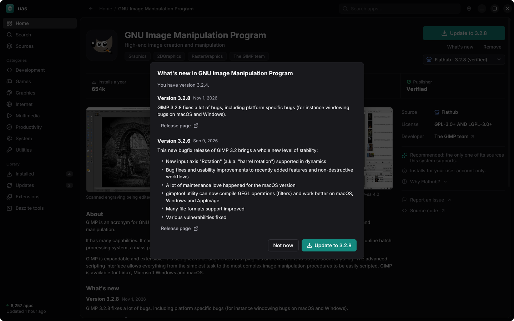
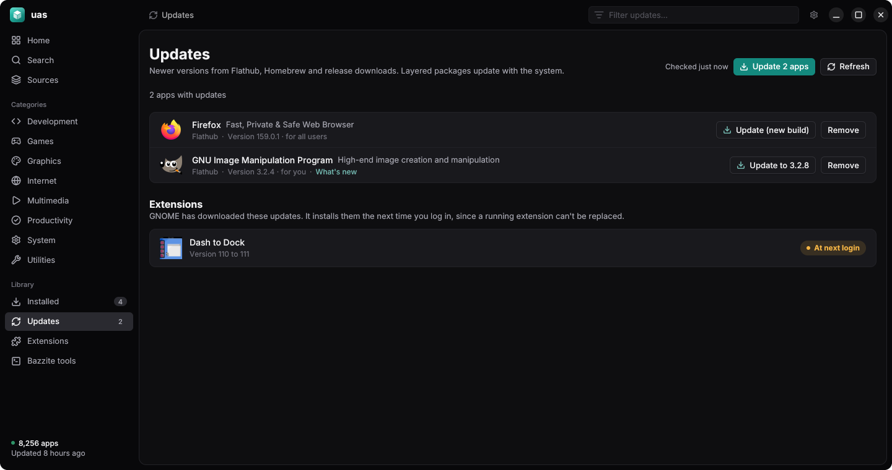
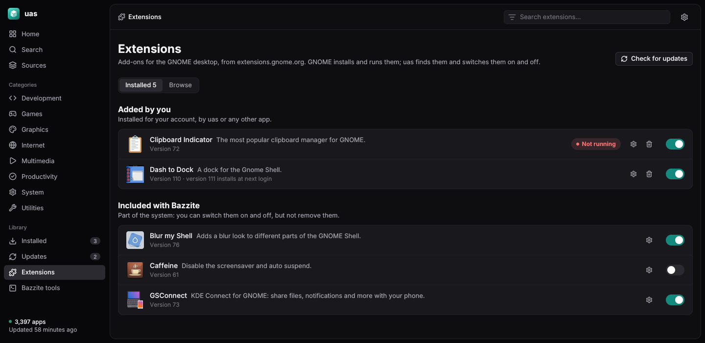
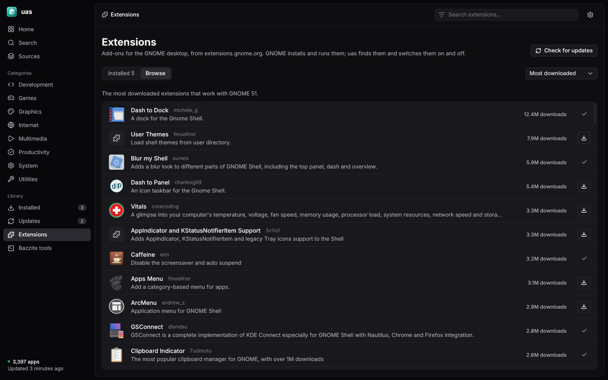
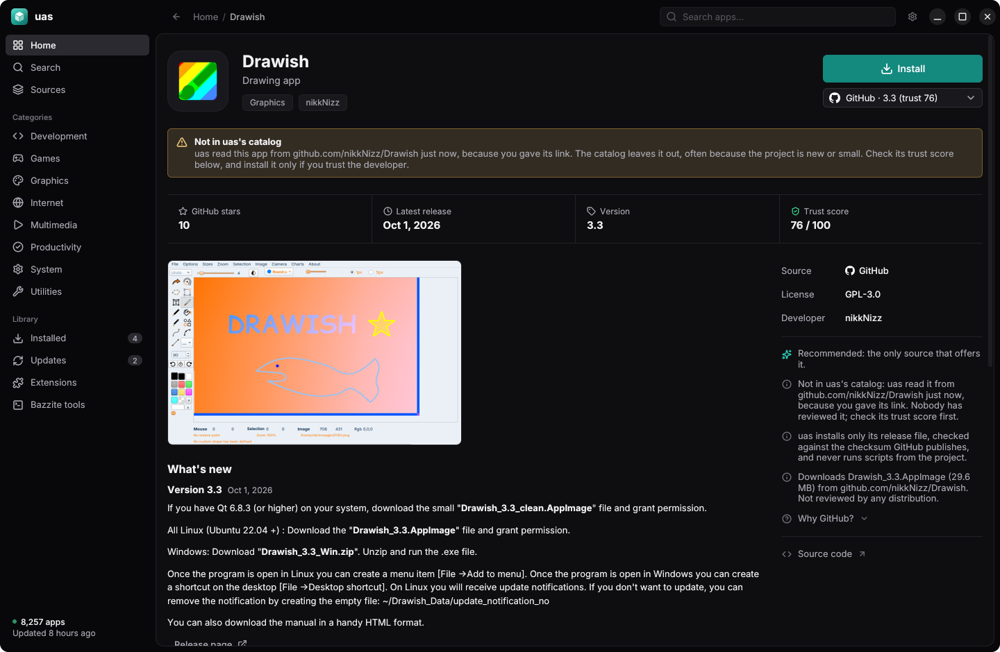
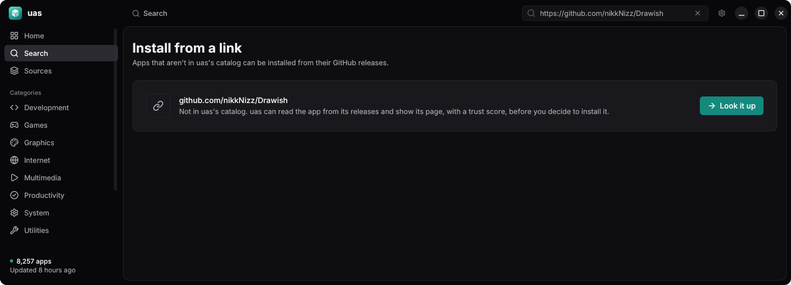

<div align="center">


# uas

**One app store for every source.**<br>
Flathub, Homebrew, the Snap Store, GitHub and Codeberg releases, and Fedora, Debian, Ubuntu, Arch and
COPR packages, searched and installed from one place.


</div>

## Features

- **One catalog for your system.** About 8,000 apps on Fedora Atomic, more or fewer depending on the system, merged so each app appears
  once with every source it's on. You download only what your system can install: Flathub, Homebrew and
  release downloads everywhere, plus your distribution's packages and, where snapd runs, snaps.
- **A recommended source.** uas picks the best fit for your system and tells you why, with the other sources a
  click away.
- **Trust scores.** GitHub and Codeberg releases and COPR projects are scored 0–100 from public signals, with the breakdown
  shown next to Install. See [docs/trust-score.md](docs/trust-score.md).
- **Install from a link.** Paste a link to an app's GitHub repo, a release or a release file into the
  search box (or use Install from a link). If the catalog has the app, its page opens; if not, because the
  project is too new or small, uas reads it from its releases and shows the same page, with the trust score
  computed on the spot and a note that it isn't in the catalog. Once installed, it updates, opens and backs
  up like any other app.
- **One list for everything installed,** whatever its source, with updates and Update all.
- **Release notes.** An app's page shows what changed in its last few versions, and an update's What's new
  shows what it brings since your version, where the source publishes notes (most Flathub apps, GitHub
  and Codeberg releases, and distribution packages' AppStream data).
- **Flatpak permissions.** Turn an app's network, file, device or sound access on or off, as Flatseal does.
- **GNOME extensions.** On GNOME, an Extensions page lists every extension on the system, whichever app
  installed it, with its switch, settings and removal, and searches the ones extensions.gnome.org has for
  your version of GNOME. GNOME Shell does the installing, and its extension updates show under Updates.
- **Your system's own tools.** On Bazzite, Bluefin and Aurora, the ujust commands (drivers, CoolerControl,
  Waydroid, audio tweaks…) are listed by group and run in a terminal window.
- **Update notifications.** Optionally, uas checks once a day and tells you when updates are ready. It never
  installs anything on its own.
- **Back up and restore.** Export the list of installed apps and GNOME extensions and install them on
  another computer, from whatever source fits it, with your Flatpak permission changes.
- **AppImages too.** Add one you downloaded and uas keeps it updated and in your app menu. Settings → Migrate
  finds the AppImages that Gear Lever, AppImageLauncher or you set up and hands the ones you pick over to uas.
- **A signed catalog,** rebuilt every 6 hours and verified before use.
- **Updates itself** from signed releases.
- **Native tools underneath.** uas installs through flatpak, brew, snap and your system's package manager (rpm-ostree, dnf, apt or
  pacman), so nothing is hidden from them.

## Screenshots

<table>
  <tr>
    <td width="50%"></td>
    <td width="50%"></td>
  </tr>
  <tr>
    <td align="center">App page</td>
    <td align="center">Search</td>
  </tr>
  <tr>
    <td width="50%"></td>
    <td width="50%"></td>
  </tr>
  <tr>
    <td align="center">Installed</td>
    <td align="center">Light theme</td>
  </tr>
  <tr>
    <td width="50%"></td>
    <td width="50%"></td>
  </tr>
  <tr>
    <td align="center">What's new</td>
    <td align="center">Updates</td>
  </tr>
  <tr>
    <td width="50%"></td>
    <td width="50%"></td>
  </tr>
  <tr>
    <td align="center">Extensions</td>
    <td align="center">Browse extensions</td>
  </tr>
  <tr>
    <td width="50%"></td>
    <td width="50%"></td>
  </tr>
  <tr>
    <td align="center">An app from a link</td>
    <td align="center">A link in search</td>
  </tr>
</table>

## Compatibility

uas runs on any Linux distribution and enables each source it finds tools for.

| Source | Needs | Works on |
| --- | --- | --- |
| Flathub | `flatpak` | Any distro |
| Homebrew | `brew` | Any distro |
| GitHub and Codeberg releases, AppImages | — (Flatpak bundles need `flatpak`) | Any distro |
| Fedora packages | `rpm-ostree`, or `dnf` and `pkexec` | Fedora Atomic (layered), or Fedora Workstation and other package-based Fedora |
| Debian and Ubuntu packages | `apt-get`, `pkexec` | Debian 13; Ubuntu 22.04, 24.04 and 26.04, and systems built on them (Linux Mint, Pop!_OS…) |
| Arch packages | `pacman`, `pkexec` | Arch and systems built on it (EndeavourOS, CachyOS…), x86_64 |
| Snap Store | `snap` with snapd running | Any distro with snapd |
| COPR | `rpm-ostree`, or `dnf` and `pkexec` | Fedora Atomic (layered), or package-based Fedora |
| GNOME Shell extensions | A GNOME session | GNOME 45 and newer |

The desktop app needs a **Wayland** session. The CLI runs anywhere.

**Tested on**

- Bazzite (Fedora 45) with GNOME, Wayland
- Bazzite with KDE Plasma, Wayland
- The CLI's apt, dnf and pacman installs in containers: Ubuntu 24.04, Debian 13, Fedora 45 and Arch
  (install, list, update and remove, as root), COPR with dnf in a Fedora 45 container (Bazaar from
  ublue-os/packages: repo, signing key, install, list and remove), and snap in an Ubuntu 24.04 container
  running systemd and snapd. The password prompt and the desktop app on those systems are untested.

**Notes for other systems**

- On Fedora Atomic, Fedora and COPR packages are layered into the image and take effect after a restart.
- On package-based systems, the distribution's own packages install with its package manager, after the
  password prompt. Arch packages update with the whole system (`sudo pacman -Syu`), not one at a time. COPR
  packages install with dnf on package-based Fedora. COPR builds only for Fedora (and RHEL-family systems,
  which uas doesn't support), so it isn't offered elsewhere.
- About one in six Arch apps has no icon: Arch ships icons only as JPEG XL, which the indexer converts, and
  some use JPEG XL features its decoder doesn't support yet.
- AppImage launchers and dock matching have only been tested on GNOME and KDE; other desktops should work
  but are untested.
- Missing `flatpak` or `brew`? Install it and those sources turn on the next time uas starts.

## Install

Download uas ([x86_64](https://github.com/tyler-builds/uas/releases/latest/download/uas-linux-x86_64),
[aarch64](https://github.com/tyler-builds/uas/releases/latest/download/uas-linux-aarch64)), allow it to run (in
its Properties, or with `chmod +x`), and open it. It installs itself, with no root needed, and opens. uas is
then in your app menu, `uas` is in `~/.local/bin`, and it updates itself (Settings → About, or
`uas self-update`).

Or from a terminal:

```sh
curl -fLo uas https://github.com/tyler-builds/uas/releases/latest/download/uas-linux-$(uname -m) && chmod +x uas && ./uas self-install && rm uas
```

Each [release](https://github.com/tyler-builds/uas/releases) also lists the programs' checksums in
`SHA256SUMS`, to compare with `sha256sum` of your download.

**Upgrading from uas 0.5.0 or older:** those versions look for updates in a place uas no longer publishes
to, so they report being up to date. Install once more with the steps above; it replaces the old copy and
keeps your apps and settings.

To uninstall, use Settings → About → Uninstall uas, or `uas self-uninstall`. Apps you installed with uas
stay installed.

From source, with Go 1.27 or newer: `go build -o /tmp/uas ./cmd/uas && /tmp/uas self-install` (builds from
source don't update themselves).

## CLI

```sh
uas search firefox
uas info org.mozilla.firefox
uas install org.mozilla.firefox
uas install https://github.com/owner/app   # an app that isn't in the catalog
```

| Command | |
| --- | --- |
| `search <words>` | Find apps |
| `info <app-id\|url>` | Show an app and its sources |
| `install <app-id\|url>` | Install from the recommended source, or from a link to the app's GitHub repo |
| `add <file.AppImage>` | Add an AppImage and keep it updated |
| `remove <app-id>` | Remove an app |
| `update <app-id>` | Update an app |
| `updates` | List available updates |
| `list` | List installed apps |
| `refresh` | Download the latest catalog |
| `system` | Show what uas detected |
| `settings [key value]` | Show or change settings (`update_checks on` turns on daily update notifications) |
| `check-updates [-notify]` | Refresh the catalog and list updates |
| `export [-o file]` | Save the list of installed apps |
| `restore <file>` | Install the apps of an export that aren't installed yet |
| `permissions <app-id> [<key> on\|off \| reset]` | Show or change what a Flatpak app may reach |
| `migrate [-n] [-y] [-all]` | Hand AppImages that other tools or you set up over to uas |
| `extensions [list \| search <words> \| install\|remove\|enable\|disable\|settings <uuid>]` | List and manage GNOME Shell extensions |
| `gui [--page <page>]` | Open the desktop app |
| `self-update` | Update uas to the latest signed release |
| `self-install` / `self-uninstall` | Install uas for you, or remove it |
| `licenses` | Show the licenses of uas and what it is built from |
| `version` | Show uas's version |

## FAQ

**Why not just use GNOME Software or KDE Discover?**<br>
They cover Flatpak and your distro's packages (and snaps, on Ubuntu). uas covers those too, plus Homebrew,
GitHub and Codeberg releases, COPR and AppImages, compares the sources an app is on, and scores the ones
no distribution reviews.

**Why not just use Flathub?**<br>
Use Flathub when it has the app; uas recommends it first for that reason. But plenty of tools aren't there: CLI
tools live in Homebrew, and many apps ship only as GitHub releases.

**Why not install GitHub releases by hand, or with Gear Lever?**<br>
You can. uas finds the release, checks its checksum, shows a trust score before you install, adds it to your
app menu and keeps it updated alongside everything else.

**Why not Distrobox?**<br>
Distrobox is great for a full distro's packages in a container. uas is for installing apps on the host from the
sources built for it. They work fine together.

**Does uas replace flatpak, brew, snap or my package manager?**<br>
No. It runs them for you: flatpak, brew, snap, and rpm-ostree, dnf, apt or pacman. Anything uas installs shows up in those tools, and anything they install shows up
in uas.

**Is installing from GitHub, Codeberg or COPR safe?**<br>
No distribution reviews those sources, so uas asks before installing, shows a trust score with its breakdown,
and verifies every download against a checksum: the one GitHub publishes, or for Codeberg, which
publishes none, the one uas recorded when it built the catalog. The score measures how well kept a project is, not
whether its code is safe. An app installed from a link isn't in the catalog at all, so its page says so, and
uas still installs only its AppImage or Flatpak bundle, checked against GitHub's checksum; it never runs
install scripts from the project.

**Does uas collect data?**<br>
No. It downloads the catalog and app icons, and talks to the sources you install from.

## How it works

```
 Flathub · Homebrew · Snap · GitHub · Codeberg
 Fedora · Debian · Ubuntu · Arch · COPR
 extensions.gnome.org
                    │
            uas-indexer (every 6h)        merge, rank, score, sign
                    │
                    ▼
  Cloudflare Worker + R2 (a catalog per kind of system)
                    │
          ┌─────────┴─────────┐
       uas gui              uas (CLI)      verify, search, install
          └─────────┬─────────┘            through the native tools
                    ▼
                your system
```

More in [docs/architecture.md](docs/architecture.md) and [docs/design.md](docs/design.md).

## Development

```sh
go test ./...
go run ./cmd/uas gui
```

Build and use a local catalog:

```sh
go run ./cmd/uas-indexer -out out/catalog.db
UAS_CATALOG=out/catalog.db go run ./cmd/uas search firefox
```

Render every page of the desktop app in both themes (the README's screenshots come from this):

```sh
UAS_SHOTS=/tmp/uas-shots UAS_CATALOG=out/catalog.db go test ./internal/gui -run TestShots
```

**Releasing.** Push a tag such as `v0.6.0` (`git tag -a v0.6.0 -m v0.6.0 && git push origin v0.6.0`). The
`Release` workflow tests, builds both architectures and creates the GitHub release with `uas-linux-x86_64`,
`uas-linux-aarch64`, `SHA256SUMS` and `uas-release.json`, signed with the `UAS_SIGNING_KEY` secret, which
installed copies check before they update themselves. It refuses a version that isn't newer than the latest
release. Run it by hand to build without publishing.

**Publishing.** The `Index` workflow builds and publishes the catalog every 6 hours, or by hand from the
Actions tab. It needs the `UAS_SIGNING_KEY` and `UAS_UPLOAD_TOKEN` secrets. The catalog Worker is in
`deploy/cloudflare`; deploy it with `npx wrangler deploy`.

## Acknowledgements

Built with [jamb](https://github.com/tyler-builds/jamb). Interface font: [Inter](https://rsms.me/inter/)
(SIL Open Font License). Source logos: the official Debian, GitHub and Codeberg logos, unchanged; see
[internal/gui/logos/README.md](internal/gui/logos/README.md). Release programs carry the licenses and notices
of everything in them (`uas licenses`).

## License

uas is licensed under the [Apache License, Version 2.0](LICENSE). Copyright 2026 tyler-builds.

Release builds use the `no_gpl` build tag, which leaves out the GPL-2.0 LZO decompressor that the SquashFS
library would otherwise include; uas then can't read the rare AppImage compressed with LZO. A build without
the tag, such as `go install` from source, includes that GPL-2.0 code.

**Trademarks.** uas is not affiliated with or endorsed by any of the projects and companies whose sources it
lists. Their names and logos are trademarks of their owners, used only to say where an app comes from. Debian
is a registered trademark owned by Software in the Public Interest, Inc. GitHub and the Invertocat logo are
trademarks of GitHub, Inc. Codeberg and the Codeberg Logo are trademarks of Codeberg e.V.
