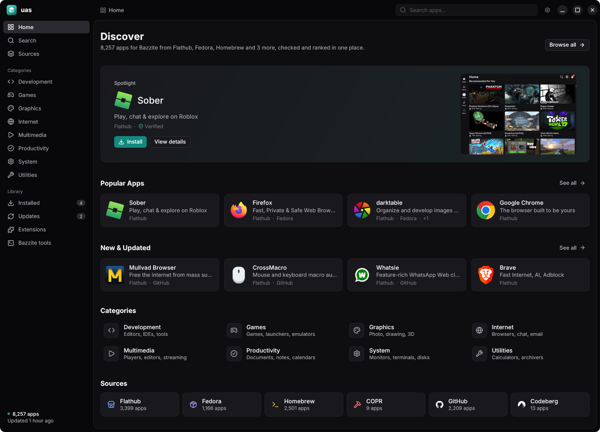
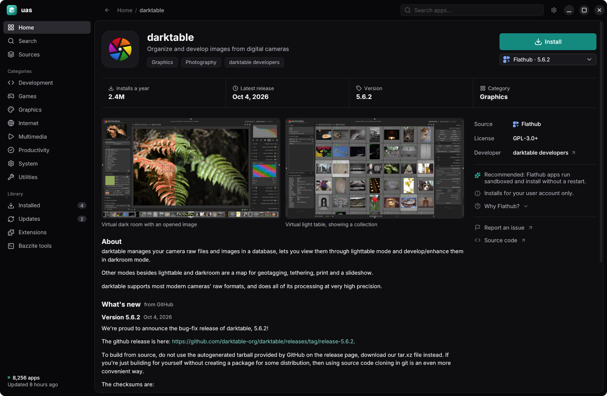
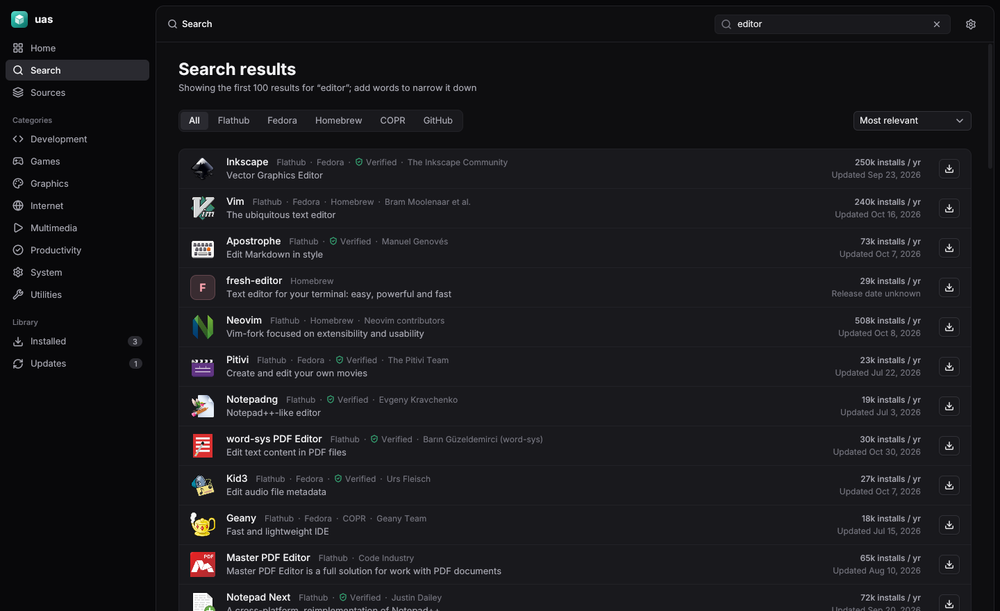
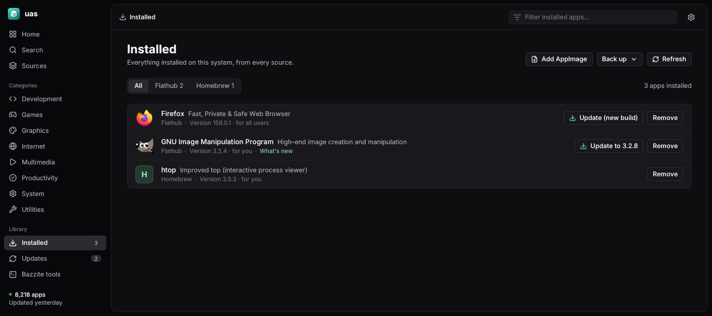
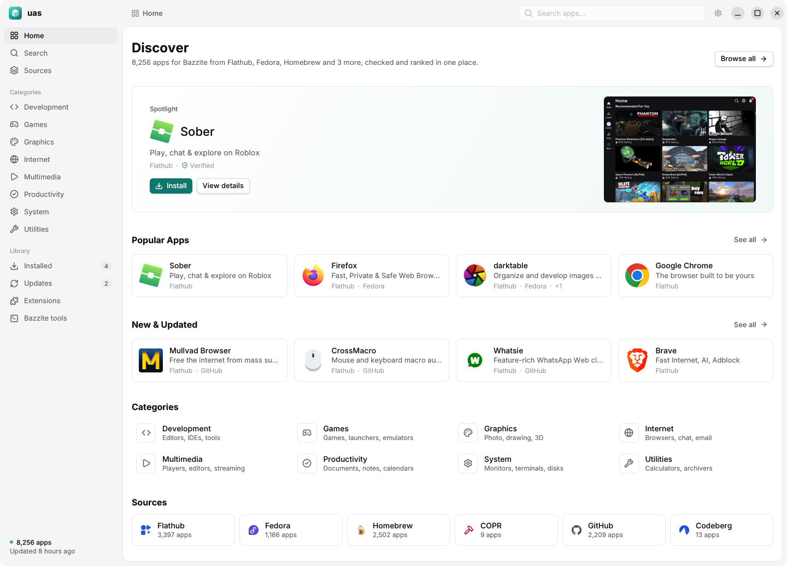

<div align="center">


# uas

**One app store for every source.**<br>
Flathub, Homebrew, the Snap Store, GitHub, GitLab and Codeberg releases, and Fedora, Debian, Ubuntu, Arch and
COPR packages, searched and installed from one place.




</div>

## Features

- **One catalog for your system.** 6,000 to 8,000 apps, depending on the system, merged so each app appears
  once with every source it's on. You download only what your system can install: Flathub, Homebrew and
  release downloads everywhere, plus your distribution's packages and, where snapd runs, snaps.
- **A recommended source.** uas picks the best fit for your system and tells you why, with the other sources a
  click away.
- **Trust scores.** GitHub, GitLab and Codeberg releases and COPR projects are scored 0–100 from public signals, with the breakdown
  shown next to Install. See [docs/trust-score.md](docs/trust-score.md).
- **One list for everything installed,** whatever its source, with updates and Update all.
- **Flatpak permissions.** Turn an app's network, file, device or sound access on or off, as Flatseal does.
- **Your system's own tools.** On Bazzite, Bluefin and Aurora, the ujust commands (drivers, CoolerControl,
  Waydroid, audio tweaks…) are listed by group and run in a terminal window.
- **Update notifications.** Optionally, uas checks once a day and tells you when updates are ready. It never
  installs anything on its own.
- **Back up and restore.** Export the list of installed apps and install them on another computer, from
  whatever source fits it, with your Flatpak permission changes.
- **AppImages too.** Add one you downloaded and uas keeps it updated and in your app menu.
- **A signed catalog,** rebuilt every 6 hours and verified before use.
- **Updates itself** from signed releases.
- **Native tools underneath.** uas installs through flatpak, brew and rpm-ostree, so nothing is hidden from them.

## Screenshots

<table>
  <tr>
    <td width="50%"></td>
    <td width="50%"></td>
  </tr>
  <tr>
    <td align="center">App page</td>
    <td align="center">Search</td>
  </tr>
  <tr>
    <td width="50%"></td>
    <td width="50%"></td>
  </tr>
  <tr>
    <td align="center">Installed</td>
    <td align="center">Light theme</td>
  </tr>
</table>

## Compatibility

uas runs on any Linux distribution and enables each source it finds tools for.

| Source | Needs | Works on |
| --- | --- | --- |
| Flathub | `flatpak` | Any distro |
| Homebrew | `brew` | Any distro |
| GitHub, GitLab and Codeberg releases, AppImages | — (Flatpak bundles need `flatpak`) | Any distro |
| Fedora packages | `rpm-ostree`, or `dnf` and `pkexec` | Fedora Atomic (layered), or Fedora Workstation and other package-based Fedora |
| Debian and Ubuntu packages | `apt-get`, `pkexec` | Debian 13; Ubuntu 22.04, 24.04 and 26.04, and systems built on them (Linux Mint, Pop!_OS…) |
| Arch packages | `pacman`, `pkexec` | Arch and systems built on it (EndeavourOS, CachyOS…), x86_64 |
| Snap Store | `snap` with snapd running | Any distro with snapd |
| COPR | `rpm-ostree`, `pkexec` | Fedora Atomic |

The desktop app needs a **Wayland** session. The CLI runs anywhere.

**Tested on**

- Bazzite (Fedora 45) with GNOME, Wayland
- Bazzite with KDE Plasma, Wayland
- The CLI's apt, dnf and pacman installs in containers: Ubuntu 24.04, Debian 13, Fedora 45 and Arch
  (install, list, update and remove, as root). The password prompt and the desktop app on those systems, and
  snap, are untested.

**Notes for other systems**

- On Fedora Atomic, Fedora and COPR packages are layered into the image and take effect after a restart.
- On package-based systems, the distribution's own packages install with its package manager, after the
  password prompt. Arch packages update with the whole system (`sudo pacman -Syu`), not one at a time. COPR
  isn't offered with dnf yet.
- About one in six Arch apps has no icon: Arch ships icons only as JPEG XL, which the indexer converts, and
  some use JPEG XL features its decoder doesn't support yet.
- AppImage launchers and dock matching have only been tested on GNOME and KDE; other desktops should work
  but are untested.
- Missing `flatpak` or `brew`? Install it and those sources turn on the next time uas starts.

## Install

From a release: download `uas-<version>-linux-x86_64.tar.gz`
(`https://uas-catalog.tyler-builds.workers.dev/releases/uas-<version>-linux-x86_64.tar.gz`), unpack it and run
`./install.sh`. uas then updates itself (Settings → About, or `uas self-update`).

From source, with Go 1.27 or newer, in a clone of this repo:

```sh
go install ./cmd/uas-gui ./cmd/uas      # to ~/go/bin; make sure it's on your PATH

# launcher entry and icon
cp packaging/linux/io.github.tyler_builds.uas.desktop ~/.local/share/applications/
cp -r packaging/linux/icons ~/.local/share/
```

## CLI

```sh
uas search firefox
uas info org.mozilla.firefox
uas install org.mozilla.firefox
```

| Command | |
| --- | --- |
| `search <words>` | Find apps |
| `info <app-id>` | Show an app and its sources |
| `install <app-id>` | Install from the recommended source |
| `add <file.AppImage>` | Add an AppImage and keep it updated |
| `remove <app-id>` | Remove an app |
| `update <app-id>` | Update an app |
| `updates` | List available updates |
| `list` | List installed apps |
| `refresh` | Download the latest catalog |
| `system` | Show what uas detected |
| `settings [key value]` | Show or change settings (`update_checks on` turns on daily update notifications) |
| `check-updates [-notify]` | Refresh the catalog and list updates |
| `export [-o file]` | Save the list of installed apps |
| `restore <file>` | Install the apps of an export that aren't installed yet |
| `permissions <app-id> [<key> on\|off \| reset]` | Show or change what a Flatpak app may reach |

## FAQ

**Why not just use GNOME Software or KDE Discover?**<br>
They cover Flatpak and your distro's packages (and snaps, on Ubuntu). uas covers those too, plus Homebrew,
GitHub, GitLab and Codeberg releases, COPR and AppImages, compares the sources an app is on, and scores the ones
no distribution reviews.

**Why not just use Flathub?**<br>
Use Flathub when it has the app; uas recommends it first for that reason. But plenty of tools aren't there: CLI
tools live in Homebrew, and many apps ship only as GitHub releases.

**Why not install GitHub releases by hand, or with Gear Lever?**<br>
You can. uas finds the release, checks its checksum, shows a trust score before you install, adds it to your
app menu and keeps it updated alongside everything else.

**Why not Distrobox?**<br>
Distrobox is great for a full distro's packages in a container. uas is for installing apps on the host from the
sources built for it. They work fine together.

**Does uas replace flatpak, brew, snap or my package manager?**<br>
No. It runs them for you: flatpak, brew, snap, and rpm-ostree, dnf, apt or pacman. Anything uas installs shows up in those tools, and anything they install shows up
in uas.

**Is installing from GitHub, GitLab, Codeberg or COPR safe?**<br>
No distribution reviews those sources, so uas asks before installing, shows a trust score with its breakdown,
and verifies every download against a checksum: the one GitHub publishes, or for GitLab and Codeberg, which
publish none, the one uas recorded when it built the catalog. The score measures how well kept a project is, not
whether its code is safe.

**Does uas collect data?**<br>
No. It downloads the catalog and app icons, and talks to the sources you install from.

## How it works

```
 Flathub · Homebrew · Snap · GitHub · GitLab · Codeberg
 Fedora · Debian · Ubuntu · Arch · COPR
                    │
            uas-indexer (every 6h)        merge, rank, score, sign
                    │
                    ▼
  Cloudflare Worker + R2 (a catalog per kind of system)
                    │
          ┌─────────┴─────────┐
       uas-gui              uas (CLI)      verify, search, install
          └─────────┬─────────┘            through the native tools
                    ▼
                your system
```

More in [docs/architecture.md](docs/architecture.md) and [docs/design.md](docs/design.md).

## Development

```sh
go test ./...
go run ./cmd/uas-gui
```

Build and use a local catalog:

```sh
go run ./cmd/uas-indexer -out out/catalog.db
UAS_CATALOG=out/catalog.db go run ./cmd/uas search firefox
```

Render every page of the desktop app in both themes (the README's screenshots come from this):

```sh
UAS_SHOTS=/tmp/uas-shots UAS_CATALOG=out/catalog.db go test ./internal/gui -run TestShots
```

**Releasing.** Push a tag such as `v0.2.0`. The `Release` workflow tests, builds both archives and publishes
them with a signed `releases/latest.json` (same secrets as the catalog). Run it by hand to build archives
without publishing. The catalog Worker must be deployed with release support first.

**Publishing.** The `Index` workflow builds and publishes the catalog every 6 hours, or by hand from the
Actions tab. It needs the `UAS_SIGNING_KEY` and `UAS_UPLOAD_TOKEN` secrets. GitLab is indexed only if the
optional `GITLAB_TOKEN` secret holds a GitLab.com personal access token with the `read_api` scope, because
GitLab allows too few keyless requests. The catalog Worker is in
`deploy/cloudflare`; deploy it with `npx wrangler deploy`.

## Acknowledgements

Built with [jamb](https://github.com/tyler-builds/jamb). Interface font: [Inter](https://rsms.me/inter/)
(SIL Open Font License). Source logos: [Simple Icons](https://simpleicons.org/).
